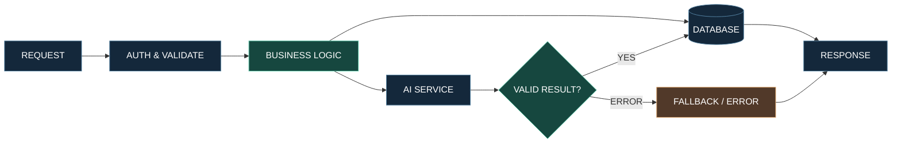

# PARK HYEONMIN

### 요청과 응답 사이를 설계합니다.

**BACKEND DEVELOPMENT · AI INTEGRATION · ENGINEERING NOTES**

> API를 만드는 것보다 중요한 건, 사용자의 요청이 검증되고 처리되고 저장되어 올바른 결과로 돌아오는 과정이라고 생각합니다.
>
> Java·Spring Boot와 TypeScript·Express로 백엔드 서비스를 구현하며, AI와 데이터베이스를 연결하는 작업을 경험했습니다.

---

## 00 / HOW I THINK

**데이터가 지나가는 모든 경계에는 검증이 필요합니다.**



*학습 서비스의 백엔드 흐름을 단순화한 개념도입니다. Fallback은 일부 AI 콘텐츠 생성 경로에 적용됩니다.*

**제가 개발 과정에서 중요하게 생각하는 세 가지**

- **Validation** — 입력값뿐 아니라 외부 서비스의 응답도 검증합니다.
- **Consistency** — 변경된 데이터와 이전 결과가 충돌하지 않도록 관리합니다.
- **Traceability** — 문제가 발생했을 때 원인과 처리 과정을 추적할 수 있어야 합니다.

---

# 01 / ENGINEERING CASES

기술 스택보다 **어떤 문제를 발견했고, 왜 그런 구현을 선택했는지**를 먼저 보여주고 싶습니다.

## CASE 01. AI가 답을 반환하지 않는다면?

**AI STUDY INDEXER / 팀 졸업작품**

`TypeScript` `Express` `PostgreSQL` `JWT` `AI API`

학습 자료를 업로드하면 요약, 퀴즈, 플래시카드, 학습 리포트 등을 생성하는 AI 기반 학습 지원 서비스입니다.

### 내가 담당한 영역

- 회원가입·로그인 및 JWT 인증 API
- 사용자 정보 조회와 과목 관리 CRUD
- AI 콘텐츠 생성 API의 백엔드 연동 및 검증
- Controller / Service / Repository 역할 분리

### 기술적으로 고민한 문제

AI 생성 요청은 일반적인 DB 조회와 다릅니다.

외부 AI 서버의 응답이 지연되거나 실패할 수 있고, 응답 구조가 예상과 다를 수도 있습니다.

따라서 단순히 AI 호출 결과를 반환하는 것이 아니라, **정상 생성과 대체 처리 여부를 구분하는 구조**가 필요했습니다.

```text
[학습 콘텐츠 생성 요청]
          |
          v
[인증 · 자료 조회]
          |
          v
[AI 생성 요청]
          |
          +--- 정상 응답 ---> 결과 검증
          |                     |
          |                     v
          |                  DB 저장
          |
          +--- 오류/미설정 ---> Fallback 또는 오류 처리
                                  |
                                  v
                              결과 응답
```

일부 생성 경로에서는 다음 정보를 통해 실제 AI 사용 여부를 구분합니다.

- `aiUsed`
- `fallbackUsed`
- `aiUrlConfigured`

**핵심은 AI가 생성한 결과와 임시 대체 결과를 같은 성공으로 취급하지 않는 것입니다.**

### SOURCE EVIDENCE

- [AI Study Indexer 전체 프로젝트](https://github.com/hyeon9654/studyindexerbackfront)
- [인증 비즈니스 로직](https://github.com/hyeon9654/studyindexerbackfront/blob/main/Back/src/services/auth.service.ts)
- [AI 요약 생성 로직](https://github.com/hyeon9654/studyindexerbackfront/blob/main/Back/src/services/ai/summaryAi.service.ts)

---

## CASE 02. 똑같은 후기를 왜 다시 분석해야 할까?

**ONCARE SCHEDULE / 국비교육 팀 프로젝트**

`Java` `Spring Boot` `JPA` `MySQL` `Gemini API`

방문요양 서비스의 후기 데이터를 분석하여 관리자에게 감정 분류와 통계를 제공하는 기능을 구현했습니다.

### 문제

후기를 조회할 때마다 AI 분석을 다시 수행한다면 불필요한 API 호출이 발생합니다.

또한 사용자가 후기 내용을 수정했는데 이전 분석 결과를 그대로 반환한다면, 실제 내용과 분석 결과가 불일치할 수 있습니다.

### 선택한 해결 방식

**후기 내용의 해시값을 기준으로 기존 분석 결과의 유효성을 검사했습니다.**

```text
후기 분석 요청
    |
    v
현재 후기 내용의 해시 계산
    |
    v
기존 분석 결과 조회
    |
    +--- 동일 해시 + 유효한 분류
    |             |
    |             v
    |       저장된 분석 결과 재사용
    |
    +--- 내용 변경 또는 미분석
                  |
                  v
             Gemini API 호출
                  |
                  v
             감정 분류 검증
                  |
                  v
             분석 결과 저장
```

### 추가한 검증

AI가 반환할 수 있는 감정 분류를 다섯 개로 제한했습니다.

`매우 긍정` · `긍정` · `중립` · `부정` · `매우 부정`

그 외의 응답은 정상적인 분류 결과로 저장하지 않습니다.

후기 별점과 분석된 감정의 방향이 다른 경우에는 불일치 여부도 별도로 표시합니다.

**이 설계는 단순한 AI 호출 기능이 아니라, 결과의 재사용과 정합성을 고려한 백엔드 구현입니다.**

### SOURCE EVIDENCE

- [ONCARE 백엔드 팀 프로젝트](https://github.com/limjunhee/oncare_backend)
- [ReviewSentimentService.java](https://github.com/limjunhee/oncare_backend/blob/main/src/main/java/oncare_backend/service/ReviewSentimentService.java)
- [AI FAQ 관리 로직](https://github.com/limjunhee/oncare_backend/blob/main/src/main/java/oncare_backend/service/AiFaqService.java)

---

## CASE 03. 고장 난 장비를 다시 대여하면?

**UNMANNED EQUIPMENT RENTAL / 미니 팀 프로젝트**

`Java` `JDBC` `MySQL` `MVC`

무인 장비 대여 시스템에서 **고장·파손 신고 기능**을 담당했습니다.

단순히 신고 데이터를 저장하는 것이 아니라, 장비의 상태 및 대여·반납 흐름과 신고 기능이 어떻게 연결되는지 이해하는 과정이었습니다.

이 프로젝트를 통해 JDBC를 이용한 DB 접근과 DAO·DTO 기반의 역할 분리를 경험했습니다.

- [프로젝트 저장소](https://github.com/hyeon9654/miniproject2)
- [ReportDAO.java](https://github.com/hyeon9654/miniproject2/blob/main/miniproject2/model/dao/ReportDAO.java)

---

# 02 / MY TOOLBOX

사용 기술을 무조건 많이 나열하지 않습니다.

| 영역 | 실제 프로젝트에서 사용한 기술 |
|:--|:--|
| **Backend** | Java, Spring Boot, TypeScript, Node.js, Express |
| **Database** | MySQL, PostgreSQL, JPA, JDBC |
| **Authentication** | JWT |
| **Frontend** | JavaScript, React, HTML, CSS |
| **AI Integration** | Gemini API, 외부 AI 서비스 연동 |
| **Collaboration** | Git, GitHub |

### NOW LEARNING

`Python` · `NumPy` · `Pandas` · `Matplotlib` · `데이터 분석`

Python 학습과 실습 기록은 별도 저장소에서 관리하고 있습니다.

[Python Learning Repository](https://github.com/hyeon9654/python)

---

# 03 / DEVELOPMENT RECORDS

| Repository | 기록 내용 |
|:--|:--|
| [AI Study Indexer](https://github.com/hyeon9654/studyindexerbackfront) | AI 학습 서비스 통합 프로젝트 |
| [Spring Boot](https://github.com/hyeon9654/springweb) | Spring Boot · 웹 백엔드 학습 |
| [Java Backend](https://github.com/hyeon9654/2026_BACKEND) | Java · DB · JDBC 실습 |
| [JavaScript / Frontend](https://github.com/hyeon9654/2026_FRONTEND) | HTML · CSS · JavaScript 실습 |
| [Python](https://github.com/hyeon9654/python) | 문법 복습 · 데이터 분석 |

---

# 04 / WHAT I'M BUILDING TOWARD

지금은 백엔드 개발의 전체 흐름을 이해한 상태에서, 개별 기능을 직접 설계하고 구현하는 능력을 강화하고 있습니다.

앞으로 집중할 부분은 다음과 같습니다.

**01 — API 설계**

요구사항을 DB 구조와 REST API로 변환하는 능력

**02 — 데이터 정합성**

트랜잭션, 예외 처리, 중복 데이터와 상태 변경 관리

**03 — 검증 가능한 코드**

단순 기능 테스트를 넘어 테스트 케이스로 정상·예외 동작을 설명하는 능력

**04 — AI 서비스 연동**

외부 AI의 응답 실패, 형식 오류, 재시도 및 결과 저장을 고려하는 설계

---

### BUILD → VERIFY → EXPLAIN

**동작을 구현하고, 결과를 검증하고, 이유를 설명하는 개발자가 되겠습니다.**

<sub>박현민 · Backend Development & AI Integration</sub>
